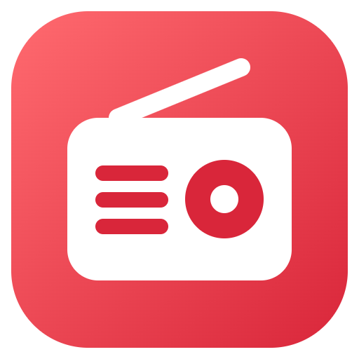
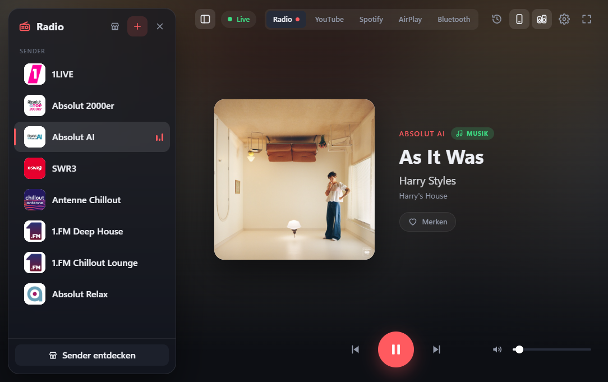
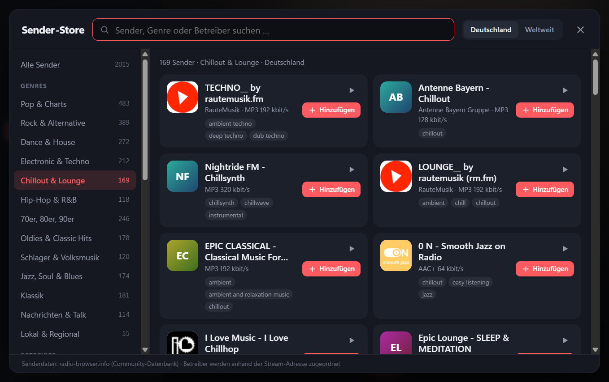
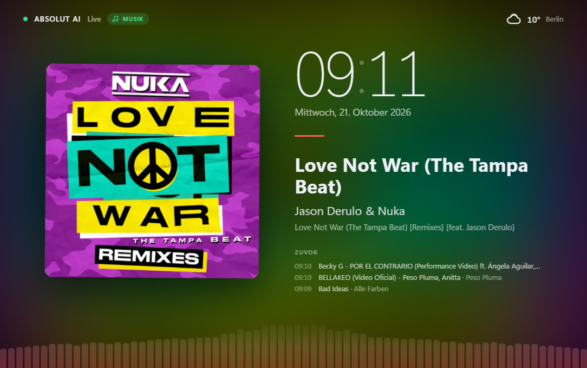
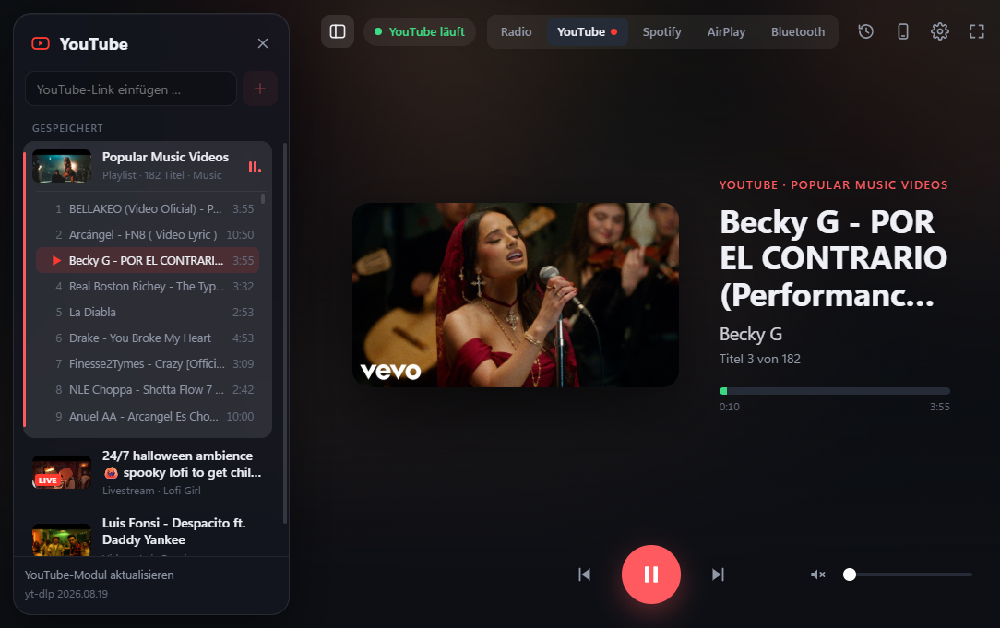
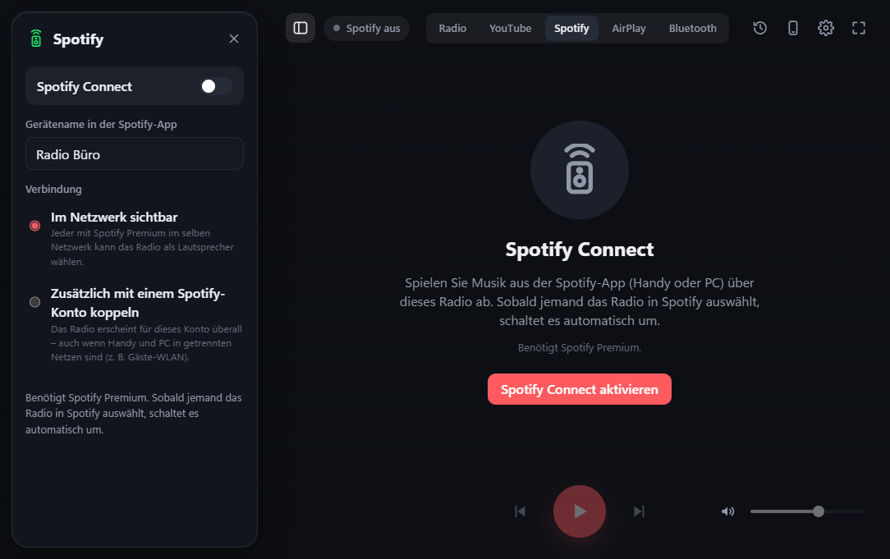
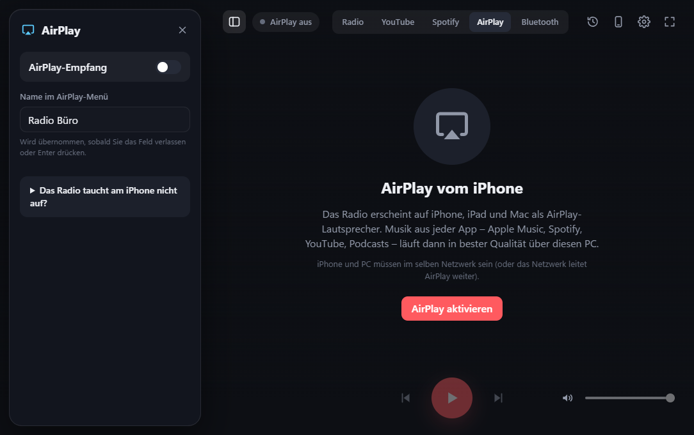
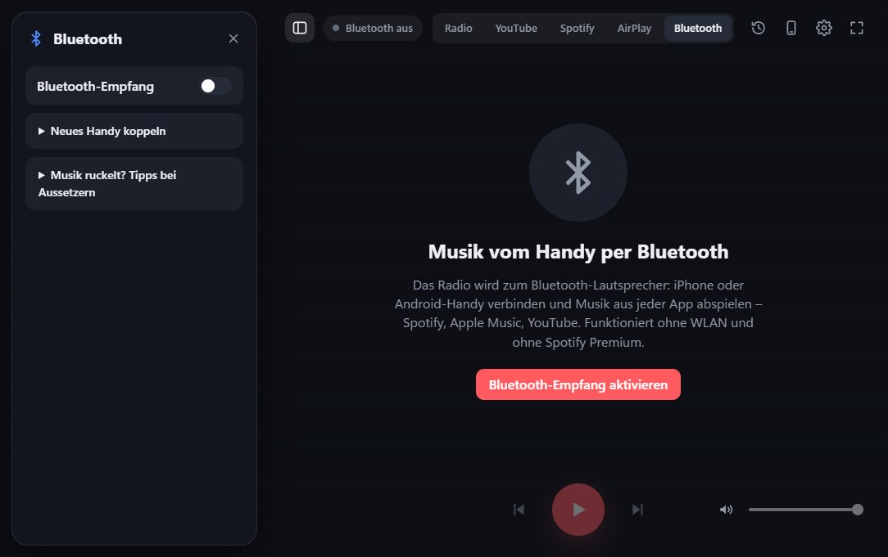
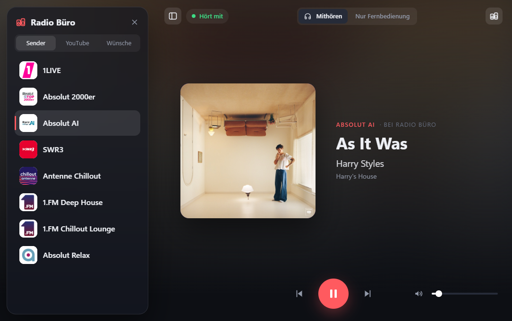

  

<h1 align="center">Radio</h1>

  Internetradio für Windows – mit Titelanzeige, Album-Covern, schöner Vollbildansicht, YouTube, Spotify Connect, AirPlay und Bluetooth. 
  Keine Installation: herunterladen, doppelklicken, Musik hören.

  <a href="https://github.com/DRLohse2004/radio-player/releases/latest/download/Radio-portable.exe"><b>⬇ Radio für Windows herunterladen</b></a>
  &nbsp;·&nbsp;
  <a href="https://github.com/DRLohse2004/radio-player/releases/latest">Alle Versionen</a>

## Was das Radio kann

- 🎵 **Sehen, was läuft:** Titel, Interpret, Album und Cover des aktuellen Songs.
- 📰 **Nachrichten oder Werbung?** Läuft gerade keine Musik, zeigt das Radio stattdessen ein passendes Symbol – soweit der Sender das mitteilt.
- 🖥️ **Vollbild mit Uhr:** Ideal für einen Bildschirm im Büro – mit Uhrzeit, Datum, Wetter und den zuletzt gespielten Songs. Damit sich nichts einbrennt, wechseln Cover und Text regelmäßig die Seiten.
- 🔍 **Sender-Store:** Tausende Sender durchsuchen, nach Genre oder Betreiber (z. B. ARD, Antenne, sunshine live) filtern, reinhören und mit einem Klick hinzufügen.
- ▶️ **YouTube ohne Werbung:** Videos, Playlists und Livestreams per Link speichern wie Sender – nur der Ton, ohne Anmeldung und ohne Werbung.
- 🍏 **AirPlay vom iPhone:** Das Radio erscheint auf iPhone, iPad und Mac als AirPlay-Lautsprecher – Musik aus jeder App in bester Qualität.
- 📱 **Vom Handy per Bluetooth:** iPhone oder Android-Handy koppeln und Musik aus jeder App abspielen – ohne WLAN, auch ohne Spotify Premium.
- 🟢 **Spotify Connect:** Das Radio erscheint in der Spotify-App als Lautsprecher. Startet jemand dort Musik, schaltet das Radio automatisch um.
- 🎧 **Rooms:** Mehrere Radios schließen sich zusammen. Ein PC ist der Host (z. B. der mit den Lautsprechern), alle anderen hören am eigenen Platz über Kopfhörer mit oder steuern ihn nur – ohne selbst Ton abzuspielen.
- 📲 **Fernbedienung übers Handy:** QR-Code scannen – Kollegen steuern Lautstärke und Wiedergabe, wechseln den Sender und wünschen sich Songs von YouTube. Ohne App, auf iPhone und Android.
- ❤️ **Verlauf & Merkliste:** Welcher Song lief gerade? Im Verlauf nachsehen, Songs merken und direkt bei Spotify oder YouTube suchen.
- 🎨 **Designs:** Neben dem Standard-Design gibt es sieben weitere – vom hellen Kofferradio mit Senderskala über den Röhrenempfänger mit VU-Metern bis zur Fallblatt-Anzeigetafel und zur modernen Konsole.
- ⏰ **Zeitplan:** Zum Beispiel Montag bis Freitag um 8 Uhr automatisch an und um 17 Uhr aus.

## Installation

1. **[Radio-portable.exe herunterladen](https://github.com/DRLohse2004/radio-player/releases/latest/download/Radio-portable.exe)** (ca. 155 MB).
2. Die Datei an einen beliebigen Ort legen, zum Beispiel auf den Desktop oder einen USB-Stick.
3. Doppelklicken – fertig. Eine Installation ist nicht nötig.

Beim **ersten Start einer neuen Version** bereitet das Radio sich einige Sekunden lang vor (mit Ladefenster). Danach startet es in etwa einer Sekunde.

> **Windows zeigt eine blaue Warnung („Der Computer wurde durch Windows geschützt“)?**
> Das passiert bei Programmen ohne kostenpflichtige Signatur. Klicken Sie auf **„Weitere Informationen“** und dann auf **„Trotzdem ausführen“**.

**Updates kommen automatisch:** Das Radio sucht selbst nach neuen Versionen und lädt sie im Hintergrund. Ist eine bereit, erscheint unten rechts „Jetzt neu starten“ – Sender und Einstellungen bleiben erhalten. Abschalten lässt sich das in den Einstellungen.

Ihre Sender und Einstellungen speichert das Radio im Ordner **`RadioPlayer-Daten`** direkt neben der .exe. Kopieren Sie beides zusammen, nehmen Sie alles mit auf einen anderen PC.

## So geht's

Oben wählen Sie den Bereich: **Radio, YouTube, Spotify, AirPlay oder Bluetooth**. Links schwebt die passende Seitenleiste – beim Radio die Sender, bei YouTube die gespeicherten Links, sonst die Einstellungen. Mit dem Symbol oben links blenden Sie sie aus und ein.
In der Mitte steht immer der Player. Er zeigt, was gerade läuft – auch wenn Sie in einen anderen Bereich wechseln.

### Sender hören und verwalten

- **Sender anklicken** – er spielt sofort.
- **Leertaste** = Pause/Weiter, **Pfeiltasten ← →** = vorheriger/nächster Sender, **↑ ↓** = Lautstärke, **1–9** = Sender direkt. Alle Tastenkürzel stehen unter **Einstellungen → Tastenkürzel** und gelten in jedem Design.
- Weitere Sender finden Sie über **„Sender entdecken“** unten links.
- Eigene Sender fügen Sie mit **„+“** hinzu (Name und Stream-Adresse genügen – das Logo sucht das Radio selbst).
- Mit der Maus über einen Sender fahren, um ihn zu **bearbeiten** oder zu **löschen**. Die Reihenfolge ändern Sie per **Ziehen**.

### Vollbild für den Büro-Bildschirm

Taste **F11** oder das Symbol oben rechts. Mit **Esc** geht es zurück.
In den **Einstellungen** (Zahnrad) legen Sie den Ort für das Wetter fest und wie oft Cover und Text die Seiten tauschen.

### YouTube

1. Oben auf **„YouTube“** wechseln.
2. Links oben suchen – nach Songs, Interpreten oder Playlists – oder einen Link einfügen (aus der Adresszeile des Browsers oder in der YouTube-App über **„Teilen → Link kopieren“**).
3. Ein Klick auf den Treffer spielt ihn sofort (auch wenn gerade das Radio läuft). **„+“** (bzw. **„Alle“** bei einer Playlist) hängt ihn hinten an die **Queue**, **✓** legt ihn unter **„Gespeichert“** ab.

**Die Queue** steht in der Mitte des Reiters. Ganz oben die Karte „Läuft gerade“ mit Bild und Fortschritt, darunter „Als Nächstes“. Läuft gerade etwas anderes (z. B. das Radio), zeigt die Seitenleiste die Queue mit **„▶ Queue abspielen“**; oben in der Leiste schalten Sie jederzeit zwischen **Queue** und **Gespeichert** um. Ist ein Song zu Ende oder drückt man „Weiter“, rückt der nächste nach. Die Reihenfolge ändern Sie per Ziehen – wer den laufenden Eintrag nach unten zieht, startet damit den, der dann oben steht. Playlists stehen als ein Eintrag in der Queue und klappen per Klick ihre Songs auf; einzelne Songs lassen sich innerhalb der Playlist verschieben oder aus ihr heraus an eine beliebige Stelle der Queue ziehen. Wünsche vom Handy und aus dem Room landen in derselben Queue (hinten).

**Gespeichert:** Ein Klick auf einen gespeicherten Eintrag setzt ihn ganz oben in die Queue – er spielt sofort, der bisher laufende kommt danach. **„+“** hängt ihn hinten an. Einträge lassen sich wie Sender umbenennen, löschen und per Ziehen sortieren.

Es funktionieren einzelne **Videos**, **Playlists** und **Livestreams**. Gespielt wird nur der Ton, ohne Anmeldung und ohne Werbung.

> YouTube nutzt das Open-Source-Werkzeug [yt-dlp](https://github.com/yt-dlp/yt-dlp). Ändert YouTube etwas und es klappt plötzlich nicht mehr, unten in der YouTube-Seitenleiste auf **„YouTube-Modul aktualisieren“** klicken.

### Spotify Connect

1. Oben auf **„Spotify“** wechseln und **„Spotify Connect aktivieren“** klicken.
2. Fragt Windows nach einer **Firewall-Freigabe**, für private Netzwerke erlauben.
3. In der Spotify-App auf das **Lautsprecher-Symbol** tippen und das Radio auswählen.

Benötigt **Spotify Premium**. Sind Handy und PC in getrennten Netzwerken (z. B. Gäste-WLAN), wählen Sie in der Seitenleiste die Kopplung mit Ihrem Spotify-Konto – dann erscheint das Radio überall.

> Spotify Connect nutzt den inoffiziellen Open-Source-Client [go-librespot](https://github.com/devgianlu/go-librespot). Er ist kein Produkt von Spotify und kann durch Änderungen bei Spotify jederzeit aufhören zu funktionieren.

### AirPlay vom iPhone

1. Oben auf **„AirPlay“** wechseln und **„AirPlay aktivieren“** klicken.
2. Fragt Windows nach einer **Firewall-Freigabe** für „Radio“, für das Netzwerk erlauben, in dem auch das iPhone ist.
3. Am iPhone das **Kontrollzentrum** öffnen, in der Musik-Kachel auf das **AirPlay-Symbol** tippen und das Radio auswählen.

Sobald das iPhone spielt, wechselt das Radio automatisch in den AirPlay-Reiter und zeigt Titel, Interpret, Album und Cover. Lautstärke und Steuerung bleiben am iPhone. Den Namen im AirPlay-Menü ändern Sie in der Seitenleiste.

> iPhone und PC müssen im selben Netzwerk sein – oder das Netzwerk leitet AirPlay weiter. Klappt es nicht, helfen Bluetooth oder für Spotify Spotify Connect.

### Vom Handy per Bluetooth

1. Oben auf **„Bluetooth“** wechseln und **„Bluetooth-Empfang aktivieren“** klicken.
2. **Einmalig koppeln:** am Handy die Bluetooth-Einstellungen öffnen, am PC über den Link im Radio die Windows-Bluetooth-Einstellungen öffnen → **Gerät hinzufügen → Bluetooth** → Handy wählen und den Code bestätigen.
3. Danach am iPhone im **Kontrollzentrum** auf das **AirPlay-Symbol** tippen und den PC auswählen – oder im Radio beim Handy auf **„Verbinden“** klicken.

Sobald das Handy verbunden ist, wechselt das Radio automatisch in diesen Reiter. Die Lautstärke regeln Sie am Handy. Titel und Cover erscheinen, wenn das Handy sie mitschickt. Der Reiter zeigt außerdem, über welches Gerät der Ton läuft.

> **Gut zu wissen:** Den Bluetooth-Ton empfängt und spielt Windows selbst ab. Wie stabil das klingt, hängt vom Bluetooth-Chip und -Treiber des PCs ab – auf manchen Notebooks gibt es Aussetzer. Tipps dazu stehen im Bluetooth-Reiter und unten bei den häufigen Fragen. Für Spotify ist Spotify Connect die bessere Wahl.

### Fernbedienung übers Handy

1. Oben rechts auf das **Handy-Symbol** klicken und den Zugang wählen:
   - **Aus** – niemand kann sich verbinden.
   - **Öffentlich** – wer den QR-Code scannt, ist drin.
   - **Sicher** – das Handy braucht zusätzlich die **Zugangs-PIN** oder einen **Einmalcode**: Beim Verbinden auf „Code am Radio anzeigen“ tippen, dann erscheint der Code groß auf dem Radio und verschwindet wieder, sobald das Handy verbunden ist. Ein Handy muss das nur einmal machen.
2. Fragt Windows nach einer **Firewall-Freigabe** für „Radio“, für Ihr Netzwerk erlauben.
3. Den **QR-Code** mit dem Handy scannen – die Fernbedienung öffnet sich im Browser. Über „Zum Home-Bildschirm“ wird daraus eine App.

Am Handy gibt es:

- **Steuerung:** Pause/Weiter, vor und zurück, Lautstärke – und anzeigen, was gerade läuft.
- **Sender:** antippen, und er spielt.
- **Queue:** Song, Interpret, Playlist oder einen YouTube-Link suchen und mit **„+“** in die Queue setzen. Eine Playlist klappt beim Antippen ihre Songs zum einzelnen Wünschen auf; **„Alle“** setzt die ganze Playlist als einen Eintrag in die Queue. Oben steht, was gerade läuft; Wünsche stellen sich hinten an. Läuft gar nichts, startet ein Wunsch sofort; läuft das Radio, startet „Jetzt spielen“ die Queue.

Im Fernbedienungs-Fenster am PC legen Sie fest, was alle dürfen (Lautstärke, Pause/Weiter, Sender), wie viele offene Wünsche jeder haben darf und wie lang ein Song höchstens sein darf. Mit einer **Admin-PIN** darf man am Handy zusätzlich fremde Wünsche löschen und am Griff **≡** per Finger umsortieren – auch die Songs einer aufgeklappten Playlist; **„↥“** holt einen Song ganz nach oben, er spielt dann sofort. Auf Wunsch zeigt das Vollbild den QR-Code klein unten links.

> Handy und PC müssen im selben Netzwerk sein. Die Fernbedienung nutzt Port 80 – der ist auch in abgeschotteten WLANs meist offen. „Neuen QR-Code erzeugen“ sperrt alle bisherigen Handys aus.

### Rooms: mehrere Radios zusammen

Ein Radio ist der **Host** – meist der PC, an dem die Lautsprecher hängen. Dort oben rechts auf das **Room-Symbol** klicken und den Zugang wählen: **Aus**, **Öffentlich** (jedes Radio im Netz darf beitreten) oder **Sicher** (beitreten nur mit der Zugangs-PIN oder dem Einmalcode, der beim Beitreten groß auf dem Host erscheint).

An jedem anderen Radio ebenfalls das Room-Symbol öffnen: Das Radio sucht im Netz und zeigt gefundene Rooms. Dann wählen:

- **Mithören:** Das eigene Radio spielt dasselbe wie der Host – z. B. über Kopfhörer, mit eigener Lautstärke. Steigt man mitten im Song ein, setzt es an derselben Stelle ein.
- **Nur Fernbedienung:** Kein Ton am eigenen PC; Play/Pause, Weiter, Sender, Lautstärke und Wünsche steuern den Host.

Zwischen beidem lässt sich oben in der Mitte jederzeit umschalten; das Vollbild (F11) gibt es auch im Room. Die Seitenleiste im Room sieht aus wie am Host: Sender, YouTube mit Suche und gespeicherten Einträgen; spielt der Host YouTube, steht die Queue in der Mitte. Was Gäste nicht dürfen, ist ausgegraut oder ausgeblendet; was sie dürfen, gilt wie bei der Handy-Fernbedienung. Wer sich oben in der Seitenleiste mit der **Admin-PIN** des Hosts anmeldet, kann alles wie am Host: Sender hinzufügen, bearbeiten, löschen und sortieren, den Sender-Store nutzen, YouTube-Einträge speichern und verwalten, Queue und Songs sortieren. Admins bekommen außerdem den Bereich **„Empfang“** und kann dort Spotify Connect und AirPlay am Host ein- und ausschalten. Die eigenen Einstellungen (oben rechts) bleiben auch im Room erreichbar. „Room verlassen“ bringt die eigenen Sender und Einstellungen unverändert zurück.

> Findet die Suche den Host nicht (z. B. weil er in einem anderen Netz hängt), unter **„Auch in diesen Netzen suchen“** das Netz des Hosts eintragen, z. B. `10.0.11.255` oder `10.0.255.255` für alle 10.0.x.x-Netze – oder direkt seine Adresse eintragen, sie steht beim Host im Room-Fenster. Mithören geht für Radiosender und YouTube; Spotify, AirPlay und Bluetooth kommen nur beim Host an und laufen dort weiter.

### Reiter ausblenden

Unter **Einstellungen → Reiter** haken Sie an, welche Reiter oben zu sehen sind. Wer z. B. nur Radio und YouTube braucht, blendet Spotify, AirPlay und Bluetooth aus – deren Empfänger laufen dann auch nicht. Die Einstellungen dazu bleiben erhalten; ein Reiter bleibt immer sichtbar.

### Design wählen

Unter **Einstellungen → Design** wählen Sie das Aussehen. Das **Standard**-Design bleibt unverändert; dazu kommen:

- **Kofferradio** – hell und sachlich, mit Senderskala, Stationstasten und Lautsprechergitter
- **Phosphor** – bernsteinfarbenes Terminal mit Spektrum und Tastenkürzeln
- **Röhrenempfänger** – Nussbaumrahmen, leuchtende Skala, VU-Meter, die zur Musik ausschlagen
- **Plakat** – Knallgelb, dicke Rahmen, riesige Schrift und bunte Senderkacheln
- **Wohnzimmer** – dunkles Olivgrün mit Senderregal aus Eiche
- **Anzeigetafel** – Titel als Fallblattanzeige, Sender als Tafel wie am Bahnhof
- **Terminal** – moderne Konsole in JetBrains Mono; jeder Knopf zeigt sein Tastenkürzel, alles bleibt mit der Maus bedienbar

Skala, Tasten, Regal, Tafel und Terminal zeigen die ersten acht Sender; der laufende ist immer dabei. Alle Schriften sind in die App eingebaut und funktionieren auch offline.

### Automatisch starten

Unter **Einstellungen** (Zahnrad):

- **Mit Windows starten** – das Radio öffnet sich nach der Anmeldung.
- **Beim Start automatisch abspielen** und **im Vollbild starten**.
- **Zeitplan** – an bestimmten Tagen zu festen Uhrzeiten ein- und ausschalten.

## Häufige Fragen

**Ein Sender spielt nicht.**
Manche Sender ändern ihre Stream-Adresse. Suchen Sie den Sender im Sender-Store erneut oder tragen Sie die neue Adresse über „Bearbeiten“ ein.

**Es wird kein Titel oder Cover angezeigt.**
Nicht jeder Sender verschickt Titelinformationen – manche nur den Sendernamen oder Werbetexte. Dann sehen Sie das Senderlogo.

**Das Radio taucht in Spotify nicht auf.**
Prüfen Sie, ob Handy und PC im selben Netzwerk sind und ob die Firewall-Freigabe erteilt wurde. Alternativ in den Spotify-Optionen das Konto koppeln.

**AirPlay: Das Radio taucht am iPhone nicht auf.**
iPhone und PC müssen im selben Netzwerk sein (oder das Netzwerk muss AirPlay weiterleiten), und die Windows-Firewall muss „Radio“ erlauben. AirPlay im Radio kurz aus- und wieder einschalten. Klappt es weiterhin nicht, Bluetooth oder Spotify Connect mit Konto-Kopplung nutzen.

**Bluetooth: Die Musik ruckelt.**
Das liegt an Windows bzw. dem Bluetooth-Chip des PCs, nicht am Radio. Was oft hilft:
- Energiemodus **„Beste Leistung“** wählen (Einstellungen → System → Energie & Akku).
- Den Ton **nicht über Funk-Kopfhörer oder -Headsets** ausgeben – sie funken im selben Band wie Bluetooth. Der Bluetooth-Reiter zeigt an, wohin der Ton gerade geht.
- Das Handy **nah am PC** ablegen.
- Hilft das nicht: ein **USB-Bluetooth-Stick** statt des eingebauten Chips. Für Spotify alternativ **Spotify Connect** nutzen.

**Bluetooth: Das Handy lässt sich nicht verbinden.**
Der PC braucht Bluetooth und Windows 10 (ab Version 2004) oder Windows 11. Prüfen Sie, ob das Handy in den Windows-Bluetooth-Einstellungen als gekoppelt erscheint, und bleiben Sie in Reichweite (ca. 10 m).

**Welche Daten werden ins Internet geschickt?**
Für Cover und Logos fragt das Radio frei verfügbare Dienste ab (iTunes-Suche, radio-browser.info), für das Wetter Open-Meteo. Dabei werden Songtitel, Sendernamen bzw. der eingestellte Ort übertragen – keine persönlichen Daten.

---

Technische Informationen für Entwickler: **[TECHNIK.md](TECHNIK.md)**

## Lizenz

MIT – siehe [LICENSE](LICENSE). Mitgelieferte Fremdprogramme (go-librespot, yt-dlp, ALAC-Decoder) stehen unter ihren eigenen Lizenzen, siehe [TECHNIK.md](TECHNIK.md#fremdcode-und-lizenzen).
